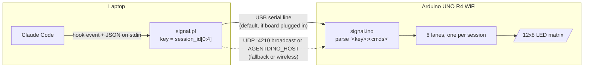
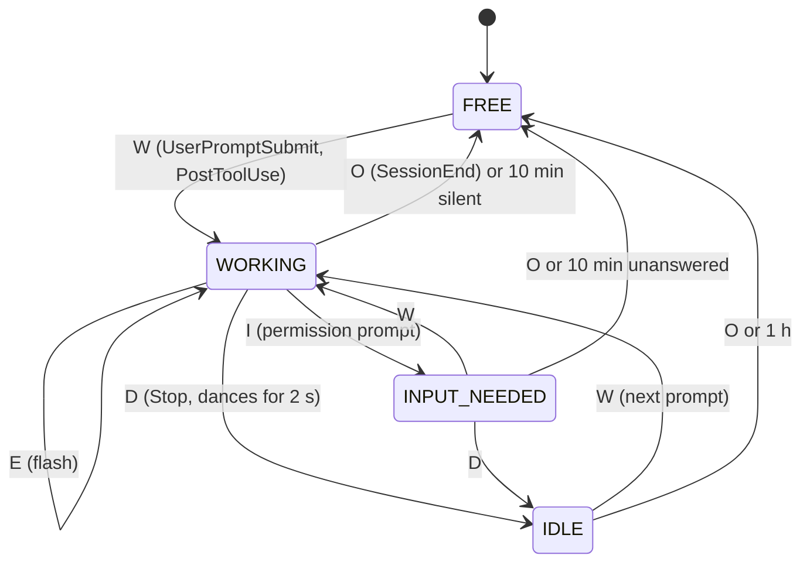

<p align="center">
  
</p>

An Arduino UNO R4 WiFi that shows Claude Code's status on its 12x8 LED matrix, one lane per Claude session. Claude Code hooks send commands to the board over USB serial or UDP.

## How it works



Each lane follows the session's hooks:



## Quick start

You need an Arduino UNO R4 WiFi, a USB cable, macOS or Linux with Perl, and [`arduino-cli`](https://arduino.github.io/arduino-cli/) with the `arduino:renesas_uno` core.

1. Optional WiFi: copy `signal/arduino_secrets.h.example` to `signal/arduino_secrets.h` and fill in a 2.4 GHz network. The USB cable alone is enough, and the file is gitignored. The sketch includes it, so it must exist to compile.
2. Flash the board:
   ```sh
   arduino-cli compile --fqbn arduino:renesas_uno:unor4wifi signal
   arduino-cli upload -p /dev/cu.usbmodem* --fqbn arduino:renesas_uno:unor4wifi signal
   ```
3. Merge the `hooks` from `hooks.example.json` into `~/.claude/settings.json`, replacing `/path/to/agentdino` with this directory, and restart Claude Code.
4. Try it without Claude: `printf '{"session_id":"abcd-1"}' | ./signal.pl OW` shows the working dino, and the same with `O` instead of `OW` clears it. `./debug.pl` shows what the board sees.

See [AGENTS.md](AGENTS.md) for the protocol, hook wiring and troubleshooting.
